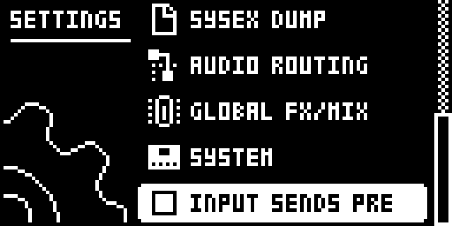
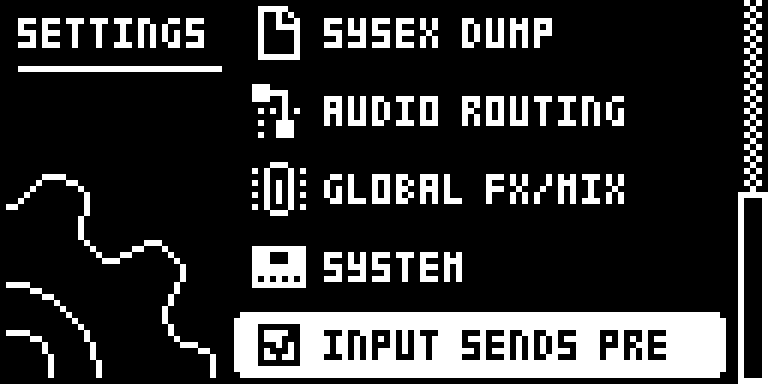

# Input Pre-Fader Sends

## Overview

Stock, the Digitakt takes the delay and reverb sends of the external inputs (IN L and IN R) after their External Mixer LEV. Turning LEV down therefore also turns down what the inputs send to the effects, and at LEV 0 the delay and reverb hear nothing of them.

With **SETTINGS > INPUT SENDS PRE** ticked, the inputs' DEL and REV sends are taken before LEV instead (still after PAN). LEV then sets only the dry inputs on the mains, so at LEV 0 an input goes fully wet: the effects get it, the mains get only the effects' return. The sends are then what stock sends at LEV 127.

Unticked, the mixer runs exactly the stock instructions. Tracks 1-8, DUAL MONO, PAN and every other mixer setting are unchanged in both modes.

Version **0.1.0-experimental** for Digitakt I OS **1.54** on Core 2.1.

## Controls

| Control | Action |
| --- | --- |
| SETTINGS > INPUT SENDS PRE | Ticked: IN L and IN R send to the delay and reverb before their LEV (PRE). Unticked: stock post-fader sends (POST). YES toggles it; RIGHT ticks and LEFT unticks it. Unticked at every power-on. |
| External Mixer DEL, REV, PAN, LEV, DUAL | As stock. In PRE, LEV no longer changes the sends. |

## Usage

The row is in the stock SETTINGS menu. The External Mixer is the last master page.

### Where to find it

SETTINGS > INPUT SENDS PRE

1. Use a build containing Input Pre-Fader Sends for the original Digitakt on OS 1.54.
2. Press SETTINGS and go to the INPUT SENDS PRE row with UP/DOWN.
3. Press YES to tick it (PRE) or untick it (POST, stock). LEFT and RIGHT also untick and tick it.
4. Press FUNC + LFO until the External Mixer page, and set IN L/IN R LEV, DEL and REV as usual.

### Quick tutorial: a 100% wet input

1. Connect a source to IN L and IN R, open the External Mixer (FUNC + LFO until its page) and turn the inputs' DEL or REV up so you hear the effect.
2. Turn IN L and IN R LEV down to 0. With the row unticked (stock) the inputs and their effect go silent.
3. Open SETTINGS and tick INPUT SENDS PRE. The dry inputs stay silent, and the delay and reverb now get them as if LEV were at full: 100% wet.
4. Raise LEV again to blend the dry inputs back in; the sends stay the same. Untick the row to return to stock post-fader sends.

## Compatibility and limitations

Requires Core 2.1. Built for OS 1.54 only.

- **Not saved.** The row starts unticked (stock) at every power-on and applies to every project and pattern. Projects and patterns store nothing for it, so they load the same on a stock OS.
- **After PAN.** PRE sends still follow PAN, as stock sends do; only LEV is bypassed.
- **Louder sends at low LEV.** In PRE the sends equal stock's at LEV 127, so switching to PRE with a low LEV raises the effects' level. The mixer's own smoothing glides the change.
- **What it patches.** Two sites inside the render's mixer routine on OS 1.54: the dry-gain multiply at 0x40071e36 (8 bytes) and the send multiply at 0x40071eb4 (24 bytes). Both are `jsr` patches that return with `rts`. They overlap no other Modwerk module's bytes. They also run from Digi Health's FAST AUDIO copy of the render in SRAM: there is no PC-relative code and no address FAST AUDIO has to relocate in either site. Digi EQ's site at 0x400721e6 sits in the same routine, apart.
- **Stock flows.** It adds one SETTINGS row (`settings:INPUT SENDS PRE`) and changes no stock page, gesture or saved data. With the row unticked the render is stock.

## Tests and measurements

See [TESTING.md](TESTING.md) for the exact evidence and the checks still open. The emulator results cover the render's arithmetic and the SETTINGS row; they do not prove audible output, timing on the unit or behaviour beside every other module on hardware.

## Authorship and licences

draadpiraat: design and code, with Claude Code assistance. Core 2.1, the hook bus and the memory map: irpina (elekloader) and Em D (digikit).
Code: [GPL-3.0-or-later](LICENSE). Screens show Elektron's interface solely to document the modification. No Elektron firmware is included.

## Screens and audio

These captures show the **OS 1.54 build with Core 2.1 and this module alone**, booted in the pinned digiemu with firmware-native drawing. See [capture provenance](media/capture.json) for hashes and panel inputs. No audio demonstration is supplied yet.

Press SETTINGS and go down to INPUT SENDS PRE, below SYSTEM. Unticked, the inputs' sends follow LEV as on the stock OS.

Press YES or RIGHT to tick it. The inputs now reach the delay and reverb whatever their LEV.
